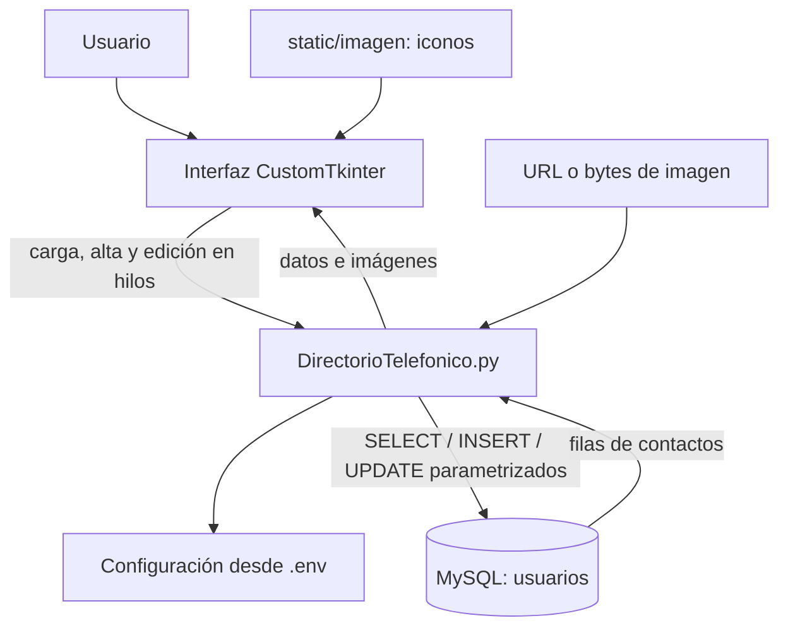

# Directorio Telefónico

Aplicación de escritorio para consultar y administrar contactos almacenados en MySQL.

## 1. Identificación del documento y datos del proyecto

| Campo | Valor |
|---|---|
| Proyecto | Directorio Telefónico |
| Tipo de documento | Documentación técnica |
| Archivo | `README.md` |
| Aplicación | Escritorio, Windows |
| Lenguaje principal | Python |
| Persistencia | MySQL |
| Versión del producto | No declarada en el código fuente |
| Versión de este documento | 1.0 |

## 2. Resumen ejecutivo

La aplicación presenta una interfaz gráfica para consultar contactos de la tabla `usuarios` de una base de datos MySQL. Permite filtrar registros localmente, ver información e imágenes asociadas, crear contactos y editar los existentes. Las operaciones de base de datos se ejecutan en hilos de trabajo para evitar bloquear la interfaz.

## 3. Función principal, alcance y exclusiones

**Función principal:** facilitar la consulta y edición de un directorio de contactos desde una aplicación de escritorio.

**Incluye:**
- Carga y visualización de contactos, con nombre, teléfono, correo, cargo e imagen.
- Búsqueda local sobre los registros cargados.
- Alta y edición de contactos. Nombre y apellido son obligatorios.
- Conexión a MySQL mediante variables de configuración externas al código.

**Fuera de alcance o no implementado:** eliminación de contactos, autenticación y roles de usuario, API HTTP, gestión o creación del esquema de base de datos, sincronización offline, y procesos automatizados de pruebas, despliegue o respaldo.

## 4. Arquitectura y flujo principal

La aplicación es monolítica: interfaz y funciones de acceso a datos residen en `DirectorioTelefonico.py`. MySQL es el almacenamiento persistente; no hay servidor web ni API.



**Flujo principal:** al iniciar, se construye la ventana y se solicita la lista de contactos. Los resultados se muestran en una lista; la búsqueda filtra los registros cargados y seleccionar uno presenta el detalle. Al guardar un alta o edición, la operación se ejecuta en segundo plano; si tiene éxito, se vuelve a cargar la lista. Los errores de conexión o escritura se muestran en la interfaz.

## 5. Estructura real del repositorio

```text
.
├── DirectorioTelefonico.py   # Interfaz, carga de imágenes y acceso a MySQL
├── app.py                    # Servidor web Flask para el directorio
├── demo/                     # Demo web estática con datos ficticios
├── templates/                # Vistas HTML de la interfaz web
├── static/css/               # Estilos de la interfaz web
├── resource_path.py          # Resolución de rutas para desarrollo o PyInstaller
├── COMANDOS                  # Apuntes de instalación y empaquetado
├── README.md                 # Esta documentación
├── requirements.txt          # Dependencias de escritorio y web
├── static/
│   └── imagen/
│       ├── logo.ico
│       └── Copilot_20260926_145116.ico
├── .env                      # Configuración local; no publicar sus valores
└── .venv/                    # Entorno virtual local, no es código del producto
```

No se encontró un archivo de dependencias (`requirements.txt`), esquema SQL, suite de pruebas ni configuración de CI/CD en la estructura examinada. El archivo `.env` es configuración local y no debe incluirse en documentación o distribución pública.

## 6. Tecnologías, lenguajes, frameworks y dependencias

| Tecnología | Función |
|---|---|
| Python | Lenguaje y ejecución de la aplicación. |
| CustomTkinter (`customtkinter`) | Ventanas, controles y tema de la interfaz gráfica. |
| MySQL Connector/Python (`mysql-connector-python`) | Conexión y operaciones SQL con MySQL. |
| Pillow (`Pillow`) | Lectura, transformación y presentación de imágenes. |
| python-dotenv (`python-dotenv`) | Carga de variables desde `.env`. |
| Biblioteca estándar (`threading`, `pathlib`, `urllib`, entre otras) | Hilos de trabajo, rutas, lectura de imágenes remotas y utilidades. |
| Mermaid | Diagrama de arquitectura incluido en esta documentación. |

No hay versiones fijadas en un manifiesto del proyecto. Para reproducir un entorno, registre las versiones instaladas en un `requirements.txt` mantenido por el equipo.

## 7. Bases de datos, integraciones y configuración por entorno

**Base de datos:** MySQL. El programa consulta y modifica la tabla `usuarios`. Según las consultas del código, se requieren las columnas `usuario_id`, `nombre`, `apellido`, `telefono`, `email`, `role` y `EnlaceImagen`. `usuario_id` se usa como identificador; el código también espera que `nombre` y `apellido` estén disponibles. La aplicación no crea ni migra esta tabla.

**Variables esperadas en `.env`:**

| Variable | Uso | Valor predeterminado |
|---|---|---|
| `DB_HOST` | Host de MySQL; obligatorio | Ninguno |
| `DB_USER` | Usuario de MySQL; obligatorio | Ninguno |
| `DB_PASSWORD` | Contraseña de MySQL; obligatoria | Ninguno |
| `DB_PORT` | Puerto de MySQL | `3306` |
| `DB_NAME` | Nombre de la base de datos | `administracion` |

Crear un archivo `.env` local con las variables necesarias, sin agregar credenciales reales al repositorio, capturas, logs o documentación. No existen perfiles de entorno separados en el código: desarrollo y ejecución usan la configuración local disponible para el proceso.

**Integración de imágenes:** se admiten imágenes como bytes o como ruta local/URL HTTP(S). Si no se encuentra o no se puede leer la imagen, se muestra una imagen de sustitución. La consulta espera `EnlaceImagen`, y el selector de imagen reconoce varios nombres de campo posibles; el campo `EnlaceImagen` debe contener una fuente compatible para que haya imagen asociada.

## 8. Instalación, ejecución, pruebas y despliegue

Requisitos: Python instalado, acceso a un servidor MySQL compatible y esquema `usuarios` preparado previamente.

En PowerShell, desde la carpeta del proyecto:

```powershell
python -m venv .venv
.\.venv\Scripts\Activate.ps1
python -m pip install -r requirements.txt
```

Configurar `.env` con los parámetros de conexión (sin compartir sus valores) y ejecutar:

```powershell
python .\DirectorioTelefonico.py
```

### Interfaz web

Con las dependencias instaladas y `.env` configurado, iniciar el servidor local:

```powershell
python .\app.py
```

Abrir `http://127.0.0.1:5000`. La interfaz permite buscar, consultar, agregar y editar contactos en la misma tabla MySQL `usuarios`. El servidor escucha solo en la computadora local de forma predeterminada.

### Demo para portafolio

La carpeta `demo/` contiene una versión estática con datos ficticios. Se puede publicar en un hosting estático (por ejemplo, GitHub Pages) sin MySQL, credenciales ni servidor Flask. El buscador y los formularios funcionan en el navegador; los cambios no se guardan al recargar la página.

**Pruebas:** no se encontró suite automatizada ni comando de pruebas. La verificación manual mínima consiste en iniciar la aplicación, revisar la carga de contactos, filtrar, consultar detalle, crear y editar un registro, y comprobar el comportamiento cuando MySQL no está disponible.

**Despliegue:** para uso local, ejecutar con el entorno Python instalado. `COMANDOS` documenta el uso de `auto-py-to-exe` para generar un ejecutable; no se incluye configuración reproducible de empaquetado. Verificar que el ejecutable incluya los iconos necesarios, tenga acceso a `.env` y pueda conectarse al servidor MySQL. `resource_path.py` ofrece resolución de recursos para PyInstaller, pero la aplicación principal define su propia ruta base.

## 9. API/endpoints y comportamiento funcional relevante

No hay endpoints HTTP. La interfaz ofrece las siguientes operaciones funcionales y el módulo expone estas funciones de persistencia:

| Operación | Implementación | Comportamiento |
|---|---|---|
| Consultar contactos | `load_users()` | Lee los campos de `usuarios` y calcula `NombreCompleto` concatenando nombre y apellido. |
| Agregar contacto | `add_user(values)` | Inserta nombre, apellido, teléfono, correo y cargo; confirma la transacción o revierte ante error. |
| Editar contacto | `update_user(user_id, values)` | Actualiza esos campos por `usuario_id`; informa si el registro no existe. |
| Buscar | `filter_users()` | Filtra en memoria los contactos ya cargados, comparando el texto ingresado con los valores del registro. |
| Mostrar detalle | `show_user(user)` | Presenta nombre completo, teléfono, email, cargo e imagen. |

Las consultas de escritura usan parámetros SQL. El formulario transforma valores opcionales vacíos en `NULL`; para el alta y la edición valida que nombre y apellido no estén vacíos.

## 10. Operación, seguridad, privacidad, respaldo y recuperación

- Mantener el servidor MySQL accesible únicamente a los usuarios y redes que lo requieran. Usar una cuenta con privilegios mínimos sobre la base de datos necesaria.
- Proteger `.env` con permisos adecuados y no incluirlo en el control de versiones, paquetes públicos, capturas o reportes. No se documentan credenciales.
- La base contiene datos personales de contacto. Limitar el acceso, uso, retención y compartición conforme a las políticas de la organización y normativa aplicable.
- Las imágenes remotas se solicitan por URL durante la visualización, con tiempo límite. Usar fuentes confiables y considerar que la aplicación realiza solicitudes HTTP(S) externas.
- La aplicación no implementa respaldo ni recuperación. El responsable de la base de datos debe establecer respaldos regulares, protegerlos y probar su restauración. Para recuperar: restaurar la copia en MySQL mediante el procedimiento administrado, validar esquema y registros, verificar `.env` y abrir la aplicación para comprobar la lectura y edición.
- Ante fallos, revisar el mensaje mostrado, disponibilidad de MySQL, configuración local y compatibilidad de columnas. Las excepciones de lectura/escritura se presentan al usuario; no existe un sistema de monitoreo centralizado.

## 11. Soporte técnico y procedimiento de reporte

- **Contacto de soporte técnico:** Joselyn Hernández
- **Teléfono:** +507 6304-2189
- **Correo electrónico:** ac1joselyn@gmail.com

Al reportar un problema, incluir:

1. Sistema operativo, versión de Python y versiones de dependencias instaladas.
2. Pasos para reproducir el problema, resultado esperado y resultado observado.
3. Momento aproximado del incidente y operación afectada (consulta, alta, edición o imagen).
4. Mensaje de error y, si aplica, detalles de conectividad con MySQL.

Antes de compartir el reporte, eliminar contraseñas, valores de `.env`, datos personales de contactos, contenido de la base y URLs privadas.

## 12. Versión, fecha de actualización e historial de cambios

| Versión del documento | Fecha | Cambios |
|---|---|---|
| 1.0 | 2026-10-24 | Creación de la documentación técnica a partir de la estructura y el código disponibles. |

La versión del producto no está declarada en el código ni en metadatos del proyecto. Actualizar esta documentación cuando cambien la estructura, dependencias, esquema de datos, configuración o comportamiento funcional.
